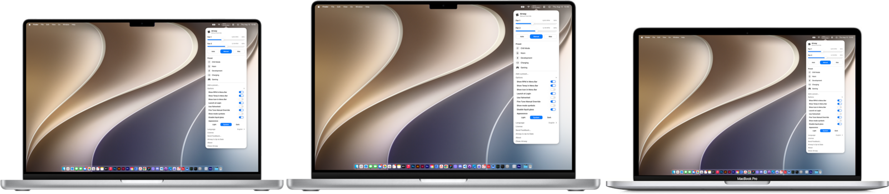
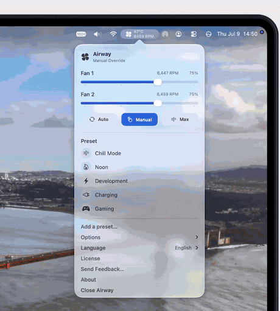
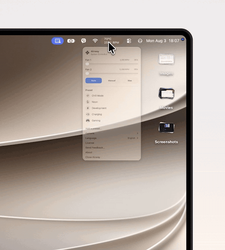
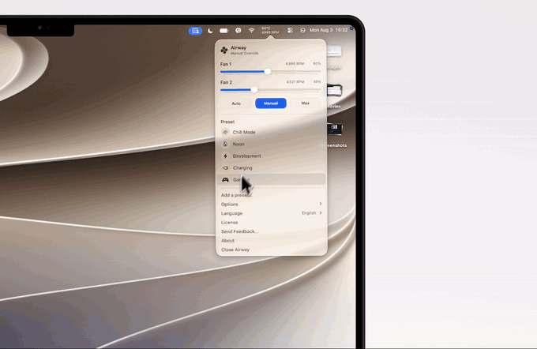
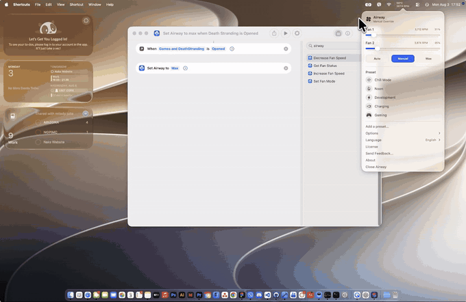
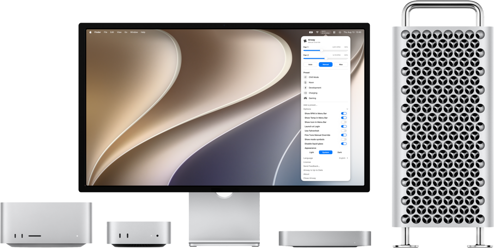

<p align="center">
  <picture>
    <source media="(prefers-color-scheme: dark)" srcset=".github/assets/icon-dark.png">
    
  </picture>
</p>

<h1 align="center">OpenAirway</h1>

<p align="center">
  <b>Your Mac runs hot. You decide how it cools.</b><br>
  The complete source code of <a href="https://airway.fan">Airway</a>, the menu bar fan control app for macOS.<br>
  Free and open source when you build it yourself.
</p>

<p align="center">
  <a href="LICENSE"></a>
  
  
  
</p>

<p align="center">
  <a href="https://airway.fan/download"><b>Download Airway</b></a>
  &nbsp;&nbsp;·&nbsp;&nbsp;
  <a href="#build-it-yourself"><b>Build it yourself for free</b></a>
</p>

<p align="center">
  
</p>

Airway puts live temperatures, fan modes, precise speed control and presets right in your menu bar. No dashboard left open. No subscription. It talks directly to your Mac's System Management Controller (SMC) through a small privileged helper, and it was made for anyone whose Mac lives in a hot room, a hot country, or under a heavy workload.

## Features

<table>
  <tr>
    <td width="50%" valign="top">
      
      <h3>Everything in the menu bar</h3>
      <p>See temperatures, check live RPM, switch modes and adjust fan speed without opening another window. The controls you use every day stay one click away.</p>
    </td>
    <td width="50%" valign="top">
      
      <h3>Three modes</h3>
      <p>Leave cooling to macOS with <b>Auto</b>, pick an exact speed for each fan with <b>Manual</b>, or jump to <b>Max</b> when a heavy job needs every bit of airflow.</p>
    </td>
  </tr>
</table>

### Presets included

Save fan setups for focused work, rendering, gaming or quiet browsing. Give each one a name and an SF Symbol, set it by RPM or percentage, and apply it from the menu bar in one click.

<p align="center">
  
</p>

### Automate with Shortcuts

Set a fan mode, check fan status, or nudge the speed up and down with Siri and the Shortcuts app. Spin the fans to Max when a game opens, and hand them back to macOS when it quits.

<p align="center">
  
</p>

### And the details

- **Live readings** of fan RPM and system temperature in the menu bar, in °C or °F.
- **Fine-tune mode** for 1% steps when 25% steps are too coarse.
- **Built-in safety:** Manual mode never drops below 25%. If a manual speed lets the Mac sit at 90 °C or hotter for three minutes, Airway takes the fans to Max until it cools down, then gives your setting back. Quitting Airway always returns the fans to macOS.
- **Launch at login**, light and dark appearance, and an option to turn off Liquid Glass.
- **Eight languages:** English, Filipino, Spanish, French, German, Japanese, Korean and Simplified Chinese.

## Works with your Mac

<p align="center">
  
</p>

| | Supported |
|---|---|
| **MacBook Pro** | Intel, M1, M2, M3, M4 and M5 (Pro and Max included) |
| **Desktop Macs** | Intel, Mac mini, Mac Studio, Mac Pro |
| **macOS** | 14 Sonoma or later. 13 Ventura works with experimental support. |

MacBook Air is not supported because it has no fan. Which fans can be controlled varies by model, and Airway backs off gracefully when direct SMC control is not available.

## Free or paid, it's the same app

The code is open, and you can build it yourself for free. Buying it gets you a ready-to-run copy and keeps the project going.

| | Build it yourself | Airway from [airway.fan](https://airway.fan) |
|---|---|---|
| **Price** | Free | $1.99 once, for two Macs ([free for students](https://airway.fan/student)) |
| **Every feature** | ✓ | ✓ |
| **Trial or license key** | Not needed | 7-day free trial, then a license |
| **Updates** | Pull and rebuild | Automatic, inside the app |
| **Needs Xcode** | Yes | No |
| **Feedback** | [GitHub Issues](https://github.com/jc-gt3rs/OpenAirway/issues) | In the app, or GitHub Issues |
| **Talks to a server** | Never | For license checks, crash reports and updates |

If Airway keeps your Mac cool, buying a license or starring this repo is the best way to say thanks.

## Build it yourself

You need a Mac with **Xcode 26 or later** (the app icon uses the Icon Composer format) and an Apple ID signed in to Xcode. A free Apple ID is enough to run Airway on your own Mac.

**1. Get the code**

```bash
git clone https://github.com/jc-gt3rs/OpenAirway.git
cd OpenAirway
```

**2. Use your own Team ID**

Airway's fan helper runs with admin rights, so the app and the helper only trust each other when both are signed by the same Apple team. Point them at yours:

```bash
# Prints your certificate details. Your Team ID is the 10 characters after OU=
security find-certificate -c "Apple Development" -p | openssl x509 -noout -subject

scripts/set-team-id.sh YOURTEAMID
```

No Apple Development certificate yet? Open Xcode, go to **Settings > Accounts**, select your Apple ID, click **Manage Certificates**, and add an **Apple Development** certificate.

**3. Build and run**

Open `Airway.xcodeproj`, choose the **Airway** scheme and **My Mac**, then press **⌘R**. To keep a copy, choose **Product > Archive**, then **Distribute App > Custom > Copy App**, and move `Airway.app` into `/Applications`.

**4. Allow the helper**

On first launch, macOS may ask you to allow Airway's background helper. If fan control does not connect, open **System Settings > General > Login Items & Extensions** and turn Airway on.

### Updating

Your Team ID changes are local edits, so set them aside while you pull:

```bash
git stash
git pull
scripts/set-team-id.sh YOURTEAMID
git stash drop
```

Then build again in Xcode.

## How it works

Airway is two programs. The menu bar app (`Airway.app`) is SwiftUI and AppKit. The privileged helper (`com.airway.helper`) is installed with `SMAppService`, runs as a launch daemon, and reads and writes SMC keys for fan speed and temperature. The two talk over XPC with `NSSecureCoding` payloads, and the helper checks the app's code signature before it accepts a connection.

[DOCUMENTATION.md](DOCUMENTATION.md) covers the architecture, SMC keys, XPC protocol, presets, safety rules and the project layout. [docs/siri-shortcuts-integration.md](docs/siri-shortcuts-integration.md) covers the App Intents.

The same source builds both editions. Without the `LICENSED` compilation condition, which is how this repository ships, you get the open edition: every feature unlocked, and no license checks, crash reports or update checks. The licensing code is still here so you can see exactly what the paid build does.

## Contributing

Bug reports, ideas and pull requests are welcome. Start with [CONTRIBUTING.md](CONTRIBUTING.md).

## Safety

Airway changes real hardware settings. It keeps a 25% floor in Manual mode, has an overheat override, and hands control back to macOS when it quits, but it comes with **no warranty**. Keep an eye on your temperatures, especially with custom speeds.

## License

OpenAirway is free software under the [GNU General Public License v3.0](LICENSE). You can use, study, change and share it. If you share a changed version, it has to stay under the GPL with its source available.

If you publish your own build, please give it a different name and icon so people don't mistake it for the official Airway.

Copyright © 2026 John Cris Antor.
